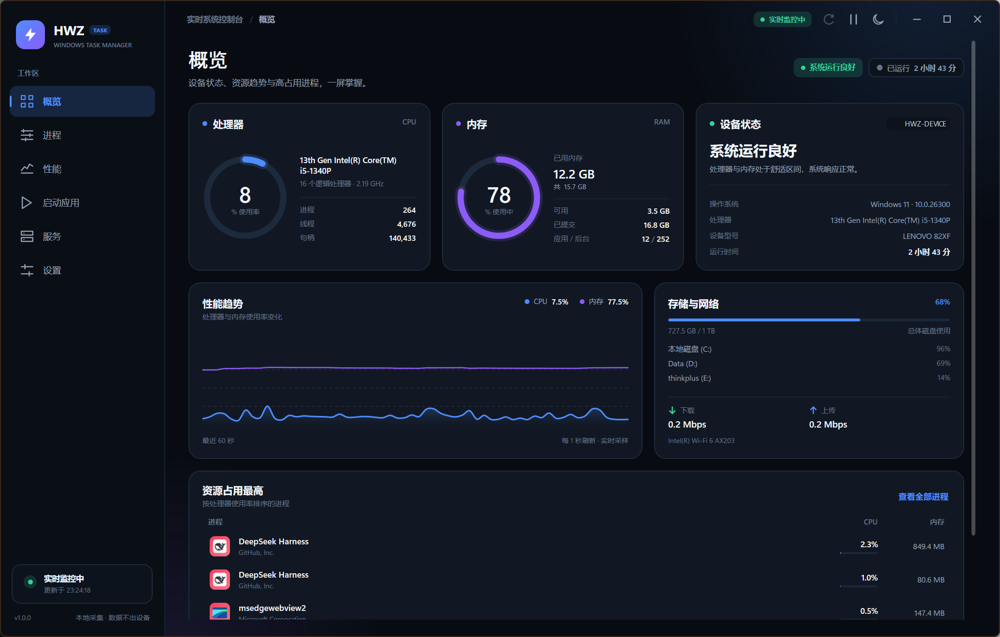
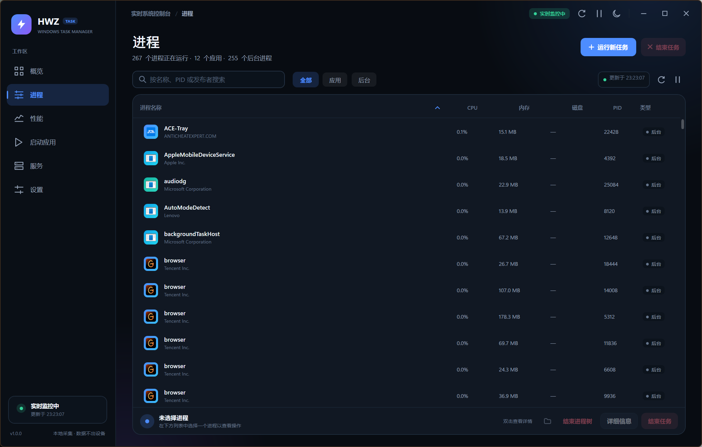
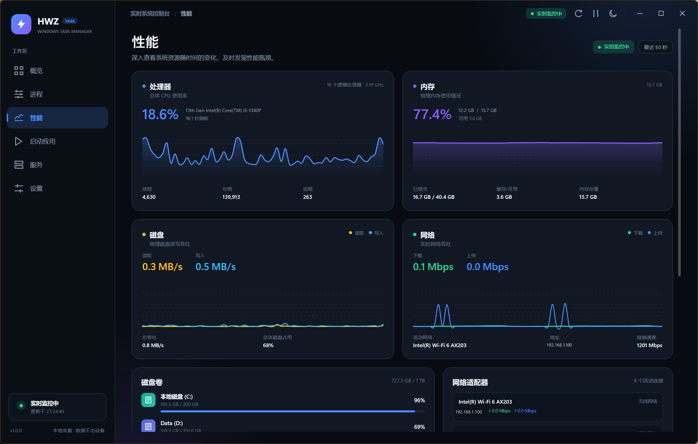
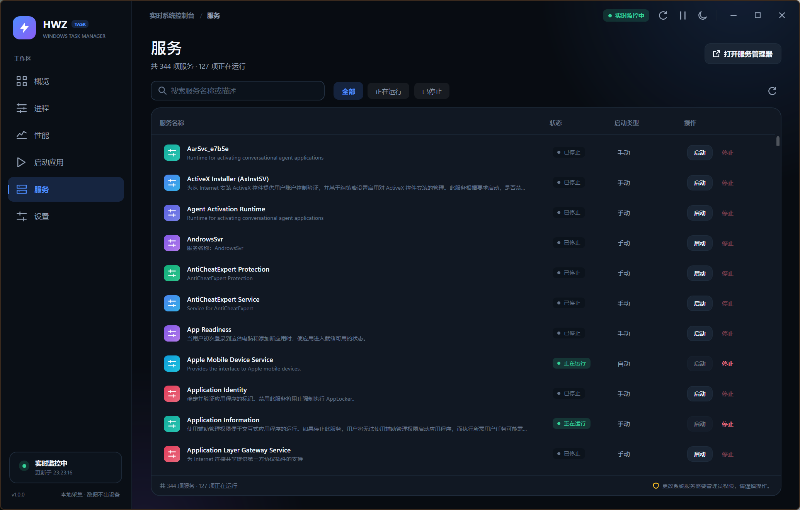

<div align="center">
  

  <h1>HWZ Windows Task Manager</h1>

  <p><strong>更现代、更简洁的 Windows 任务管理器</strong></p>

  <p>基于 WPF 与 .NET 10 构建，实时查看处理器、内存、磁盘与网络状态，轻松管理进程、服务和启动项。</p>

  <p>
    <a href="https://github.com/HWZ-ch/HWZ_Windows_TaskManager/releases/latest"></a>
    
    
    
    <a href="LICENSE"></a>
  </p>

  <p>
    <a href="#界面预览">界面预览</a> ·
    <a href="#功能特色">功能特色</a> ·
    <a href="#快速开始">快速开始</a> ·
    <a href="#快捷键">快捷键</a> ·
    <a href="https://github.com/HWZ-ch/HWZ_Windows_TaskManager/releases/latest">下载最新版本</a>
  </p>
</div>

---



## 简介

HWZ Windows Task Manager 是一款为 Windows 10 / 11 重新设计的任务管理器。它采用更具层次感的深色 / 浅色双主题界面，把系统状态、性能趋势、进程与服务管理集中在同一个轻量窗口里。

- **本地运行**：不联网、不上传数据、不需要安装额外运行环境（自包含版本）。
- **信息全面**：处理器、内存、磁盘、网络、系统信息、进程、服务与启动项。
- **操作直接**：搜索、筛选、排序、结束进程树、运行新任务、服务启停，都在几步内完成。
- **安全克制**：结束任务前确认，保护 Windows 核心进程，启动项只读展示。

## 界面预览

| 进程管理 | 性能监控 |
| :---: | :---: |
|  |  |

| 服务管理 | 浅色主题 |
| :---: | :---: |
|  |  |

## 功能特色

### 实时概览

- CPU 与内存圆环仪表，实时显示使用率和关键指标。
- 系统健康状态判断、运行时长、设备与操作系统摘要。
- 60 个采样点的 CPU / 内存趋势图。
- 磁盘容量、网络上传下载速率与活动适配器信息。
- 按 CPU 排序的高占用进程速览，一键进入进程页。

### 进程管理

- 实时进程列表：CPU、内存、磁盘 I/O、PID 与类型。
- 按名称、PID、发布者搜索；按应用 / 后台筛选；点击表头排序。
- 查看完整进程详情：路径、发布者、启动时间、线程、句柄、私有内存等。
- 结束任务或结束进程树，支持先请求窗口正常关闭。
- 打开可执行文件所在位置；复制进程详情。
- 核心系统进程受保护，避免误操作导致系统不稳定。
- 运行新任务，支持参数以及可选的“以管理员身份运行”。

### 性能监控

- 处理器、内存、磁盘、网络四张实时曲线卡片。
- 磁盘读写与网络上下行双曲线，自动缩放。
- 磁盘卷容量、活动网络适配器、地址、链接速度与吞吐。
- 采样周期可在 1 / 2 / 3 / 5 秒之间调整。

### 服务与启动项

- 浏览 Windows 服务名称、描述、运行状态与启动类型。
- 搜索、筛选，并按需启动或停止服务。
- 自动读取服务的本地化显示名称与描述。
- 读取当前用户 / 所有用户的 Run 注册表项与启动文件夹。
- 结合 Windows `StartupApproved` 判断启动项是否已启用。
- 启动项视图只读，禁用或启用请前往系统设置，避免误改配置。

### 个性化与隐私

- 深色 / 浅色 / 跟随系统三种外观。
- 窗口置顶、刷新频率、结束前确认、进程图标显示开关。
- 设置自动保存到 `%LOCALAPPDATA%\HWZ\TaskManager\settings.json`。
- 所有监控数据只在本机内存中处理；仅在程序异常时写入本地错误日志，便于排查问题。
- 不使用遥测、不建立任何网络请求。

## 快速开始

### 直接下载

前往 [Releases](https://github.com/HWZ-ch/HWZ_Windows_TaskManager/releases/latest) 下载：

```text
HWZ.TaskManager-1.0.0-win-x64.exe
```

这是自包含单文件版本，**无需安装 .NET 运行时**，双击即可运行。

> 程序未做代码签名。如果 Windows SmartScreen 拦截，请选择“更多信息” → “仍要运行”。

### 系统要求

- Windows 10 22H2 或更高版本 / Windows 11
- x64 架构
- 如需从源码构建，需要 .NET 10 SDK

### 从源码构建

```powershell
# 还原并构建
dotnet build .\HWZ.TaskManager.slnx -c Release

# 直接运行 Debug 或 Release 输出
dotnet run --project .\src\HWZ.TaskManager

# 生成自包含单文件版本（无需目标机器安装 .NET）
dotnet publish .\src\HWZ.TaskManager\HWZ.TaskManager.csproj `
  -c Release -r win-x64 --self-contained true `
  -p:PublishSingleFile=true `
  -p:EnableCompressionInSingleFile=true `
  -p:IncludeNativeLibrariesForSelfExtract=true `
  -o .\publish\win-x64
```

构建环境：Windows 10/11，.NET 10 SDK（项目已在 `global.json` 中声明 SDK 版本与向前滚动策略）。

## 快捷键

| 快捷键 | 功能 |
| :--- | :--- |
| `Ctrl` + `1` ~ `6` | 切换概览 / 进程 / 性能 / 启动应用 / 服务 / 设置 |
| `F5` 或 `Ctrl` + `R` | 立即刷新 |
| `Ctrl` + `P` | 暂停 / 继续实时监控 |
| `Ctrl` + `T` | 切换深色 / 浅色主题 |
| `Esc` | 关闭对话框 |
| `Enter` | 运行新任务对话框中确认执行 |

## 项目结构

```text
HWZ.TaskManager.slnx
├─ docs/                             # 项目图标与界面截图
└─ src/HWZ.TaskManager
   ├─ App.xaml / App.xaml.cs         # 应用入口、全局异常与主题初始化
   ├─ MainWindow.xaml                # 自定义标题栏、导航、Toast
   ├─ Controls/                      # 圆环仪表与趋势图自绘控件
   ├─ Dialogs/                       # 现代化确认 / 输入 / 详情对话框
   ├─ Helpers/                       # MVVM、主题、DWM、转换器、格式化
   ├─ Models/                        # 设置、进程、服务、启动项、快照
   ├─ Services/                      # 系统采集、服务、启动项、图标、对话框
   ├─ Themes/                        # 深色/浅色资源与控件样式
   ├─ ViewModels/MainViewModel.cs    # 界面状态、命令与刷新循环
   └─ Views/                         # 六个页面
```

## 实现要点

- **完全原生**：WPF + .NET 10，无第三方 UI 框架、无 NuGet 依赖。
- **实时采样**：`GetSystemTimes`、`GlobalMemoryStatusEx`、`GetProcessIoCounters`、PDH 磁盘计数器、`NetworkInterface` 组合采样。
- **进程信息**：`Process` API 配合原生窗口枚举、进程路径与 I/O 查询，统一计算增量。
- **服务发现**：注册表枚举服务元数据，`sc.exe` 获取运行状态；MUI 字符串通过 `SHLoadIndirectString` 本地化解析。
- **视觉细节**：自绘抗锯齿趋势图、动画圆环、Fluent 风格控件模板、深色 / 浅色动态资源、DWM 圆角与暗色标题栏。
- **中文环境优化**：处理 IME 拦截的 `Enter` / `Esc` 按键，服务显示名称支持系统本地化资源。

## 权限与已知限制

- 结束高权限进程、启动 / 停止系统服务通常需要**以管理员身份运行**。
- 启动项是只读视图；管理可用性请使用 Windows“设置 → 应用 → 启动”。
- 需保护的系统关键进程会拒绝结束，以避免系统崩溃。
- 当前版本不监控 GPU 温度 / 占用，也不提供逐进程网络流量。
- 结束进程可能导致未保存的数据丢失，请谨慎操作。
- 程序不包含代码签名证书，首次运行时可能触发 SmartScreen 提示。
- 本地错误日志位置：`%LOCALAPPDATA%\HWZ\TaskManager\error.log`。

## 许可证

项目基于 [MIT License](LICENSE) 开源。

<div align="center">
  <sub>HWZ Windows Task Manager · 为 Windows 10 / 11 打造 · 本地运行，不上传数据</sub>
</div>
